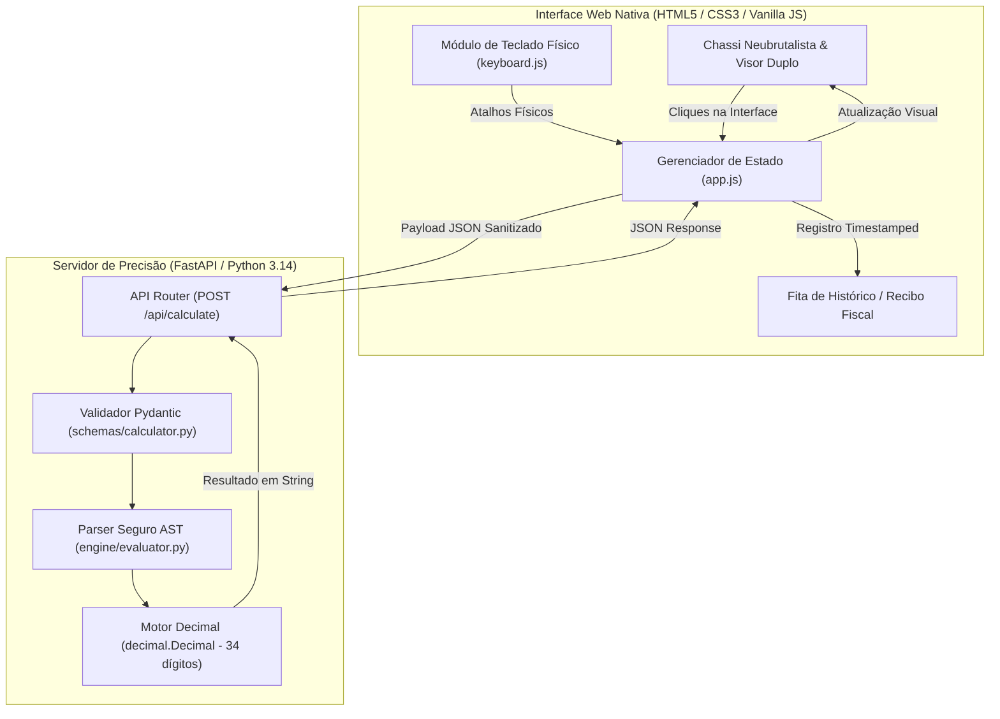

#🧮 CALCULATOR FAN — Calculadora Web Neubrutalista de Alta Precisão

Uma calculadora web com identidade visual autoral baseada no design **Neubrutalista** e arquitetura de software sólida no backend desenvolvida em **Python (FastAPI)**, sustentada por um interpretador seguro de Árvore de Sintaxe Abstrata (AST) e aritmética exata com `decimal.Decimal`.

---

## 🌟 Destaques do Projeto

* **🎨 Identidade Visual Neubrutalista:** Inspirada em publicações e layouts contemporâneos de vanguarda, com bordas pretas expressivas (`3.5px solid #000`), sombras projetadas duras sem desfoque (`box-shadow: 5px 5px 0px #000`), paleta de alto contraste (amarelo canário, rosa choque, ciano elétrico e verde neon) e microinteração física de clique mecânico (`translate(3px, 3px)`).
* **🛡️ Zero `eval()` (Segurança Absoluta):** Expressões matemáticas não são executadas diretamente pelo interpretador padrão; são parseadas em nós da árvore sintática (`ast.NodeVisitor`) aceitando exclusivamente operadores e nós numéricos autorizados.
* **🎯 Precisão Decimal Determinística (decimal128):** Elimina distorções de ponto flutuante do JavaScript (como o clássico `0.1 + 0.2 = 0.30000000000000004`). Todos os cálculos operam sob o padrão IEEE 754 de 34 dígitos decimais via `decimal.Decimal`.
* **📜 Fita de Auditoria Retrátil (Audit Tape):** Gaveta lateral no formato de bobina contínua de caixa registradora com topo serrilhado, carimbo de hora, botão de *Recall* (reutilização de resultados no visor) e exportação de recibo em arquivo `.txt`.
* **⌨️ Ergonomia Plena de Teclado Físico:** Totalmente operável via teclado físico (Numpad, operadores `+ - * /`, `Enter` para calcular, `Backspace`, `Escape` para limpar, e tecla `H` para abrir a fita) com animação sincronizada dos botões na tela.

---

## 🏗️ Arquitetura e Fluxo de Dados



---

## 📁 Estrutura de Arquivos

```text
Calculator Fan/
├── app/
│   ├── __init__.py
│   ├── main.py               # Ponto de entrada FastAPI, rotas e static files
│   ├── engine/
│   │   ├── __init__.py
│   │   ├── evaluator.py      # Avaliador seguro via ast.NodeVisitor e decimal.Decimal
│   │   └── exceptions.py     # Hierarquia de exceções customizadas do domínio
│   ├── schemas/
│   │   ├── __init__.py
│   │   └── calculator.py     # Modelos Pydantic (CalculateRequest e CalculateResponse)
│   └── static/
│       ├── index.html        # Estrutura semântica HTML5 acessível
│       ├── css/
│       │   └── style.css     # Design System Neubrutalista puro
│       └── js/
│           ├── app.js        # Estado do display, integração fetch e fita
│           └── keyboard.js   # Captura global de eventos de teclado físico
├── docs/
│   └── designs/
│       └── calculator_fan.md # Documento formal de design técnico (RFC)
├── tests/
│   ├── __init__.py
│   ├── test_evaluator.py     # Testes unitários do motor de precisão matemática
│   └── test_api.py           # Testes de integração dos endpoints FastAPI
├── concepts_brief.md         # Documento inicial de concepção e análise multi-lente
├── design_draft.md           # Rascunho de trabalho das etapas de design
├── requirements.txt          # Dependências do projeto
└── README.md                 # Documentação oficial e guia do projeto
```

---

## 🚀 Como Executar o Projeto Localmente

### 1. Pré-requisitos
* Python 3.10 ou superior instalado no sistema operacional.

### 2. Instalação das Dependências
No terminal, dentro da pasta do projeto, execute:
```bash
pip install -r requirements.txt
```

### 3. Inicialização do Servidor
Inicie o backend FastAPI com recarregamento automático:
```bash
python -m uvicorn app.main:app --reload
```
Ou simplesmente:
```bash
python app/main.py
```

### 4. Acesso no Navegador
Abra seu navegador e acesse:
```text
http://127.0.0.1:8000
```

A interface carregará imediatamente. A documentação interativa Swagger da API também fica disponível em:
```text
http://127.0.0.1:8000/docs
```

---

## 🧪 Execução dos Testes Automatizados

A suíte inclui testes unitários do motor aritmético (precisão decimal, precedência de operadores, unicode, tratamento de divisão por zero e bloqueio de injeção) e testes de integração dos endpoints da API:

```bash
python -m pytest tests/ -v
```

---

## ⌨️ Tabela de Atalhos de Teclado Suportados

| Tecla Física | Ação Correspondente |
| :--- | :--- |
| `0` a `9` | Digitação direta de operandos numéricos |
| `+`, `-`, `*`, `/` | Operações de soma, subtração, multiplicação e divisão |
| `.` ou `,` | Inserção do ponto decimal |
| `(` e `)` | Abertura e fechamento de parênteses para precedência |
| `%` | Operação de módulo |
| `^` | Potenciação ($x^y$) |
| `Enter` ou `=` | Envia a expressão para cálculo no backend |
| `Backspace` / `Delete` | Apaga o último caractere ou operador |
| `Escape` ou tecla `C` | Limpa toda a tela e o histórico imediato (`AC`) |
| `H` ou `h` | Alterna a abertura/fechamento da Fita de Histórico retrátil |
