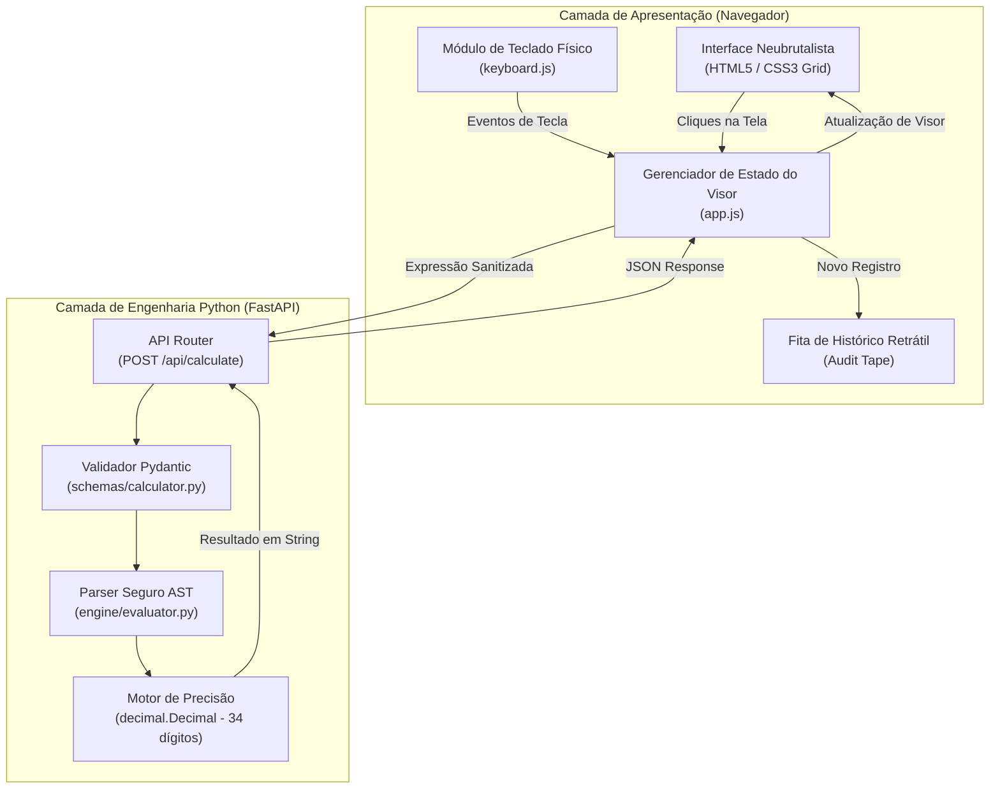

# Design Document: Calculadora Fan (Web Neubrutalista de Alta Precisão)

* **Autor:** Dev & Antigravity
* **Data:** 2026-11-01
* **Status:** Em Elaboração (Etapa: Detailed Implementation)
* **Contexto de Origem:** [concepts_brief.md](file:///C:/Users/Pichau/Documents/dev/portifolio/projetos/Imersão%20Alura/Calculator%20Fan/concepts_brief.md)

---

## 1. The Problem (O Problema)

A grande maioria das calculadoras desenvolvidas para a web recai em dois extremos indesejáveis:
1. **Fragilidade Aritmética e de Segurança:** Utilizam funções perigosas como `eval()` no backend para interpretar expressões, expondo servidores a injeção arbitrária de código, ou dependem exclusivamente do tipo `Number` (padrão IEEE-754 float binário de 64 bits) do JavaScript no navegador, o que produz distorções aritméticas inaceitáveis em operações financeiras e cotidianas simples (como `0.1 + 0.2 = 0.30000000000000004`).
2. **Defasagem Visual e Ergonômica:** Apresentam interfaces genéricas, monótonas ("vibecoder" ou temas cinzentos sem personalidade) que carecem de feedback tátil e ignoram a utilidade prática de uma fita de auditoria contínua (como a fita de papel de calculadoras mecânicas de mesa).

Há a necessidade de construir uma aplicação que una **engenharia de software sólida** (avaliação determinística sem `eval`, tolerância a falhas e exatidão decimal) a uma **identidade visual marcante no estilo Neubrutalista**, oferecendo ergonomia completa de teclado e facilidade de auditoria de cálculos em uma arquitetura web leve em Python.

---

## 2. Overview (Visão Geral)

A **Calculadora Fan** é uma aplicação web autônoma composta por um backend minimalista em **FastAPI** e uma interface nativa em **HTML5/CSS3/Vanilla JS**.

O backend atua como um motor de validação e avaliação aritmética estrita: ele consome expressões matemáticas em formato de texto, analisa sua sintaxe através da árvore de sintaxe abstrata (`ast`) do Python com lista estrita de nós permitidos e computa os valores usando aritmética decimal exata via biblioteca padrão `decimal.Decimal`.

A interface do usuário implementa o design system **Neubrutalista**, caracterizado por:
- Contornos pretos espessos e expressivos (`3.5px solid #000000`);
- Sombras projetadas rígidas sem desfoque (`5px 5px 0px #000000`);
- Micro-interação de clique mecânico que desloca o botão e reduz a sombra ao pressionar;
- Paleta saturada de alto contraste com destaque funcional para dígitos, operadores e ações de controle;
- Fita de histórico lateral retrátil (estilo bobina de caixa registradora) com carimbo de data/hora, exportação em texto e resgate instantâneo de valores para o display.

---

## 3. Goals (Objetivos em Escopo)

* **G1 - Aritmética Decimal Determinística:** Suportar as 4 operações básicas (`+`, `-`, `*`, `/`) com parênteses e precedência matemática formal, com precisão de 34 dígitos decimais (padrão IEEE 754 decimal128) e sem distorções de float binário.
* **G2 - Isolamento e Segurança Total (Zero `eval`):** Avaliar expressões exclusivamente via parser seguro baseado em nós de AST, rejeitando sumariamente quaisquer chamadas de função, variáveis, atributos ou comandos do sistema.
* **G3 - Identidade Neubrutalista Autoral:** Desenvolver um layout responsivo, limpo e visualmente surpreendente, fundamentado nos preceitos do Neubrutalismo moderno conforme referências aprovadas.
* **G4 - Ergonomia Completa de Entrada:** Proporcionar paridade total entre cliques na interface e digitação no teclado físico (teclado alfanumérico e Numpad), interceptando atalhos operacionais sem interferir na usabilidade do navegador.
* **G5 - Fita de Histórico Auditável:** Disponibilizar painel retrátil de registros com timestamp, botão de reutilização de resultados no visor atual e exportação de extrato em `.txt`.
* **G6 - Tratamento Resiliente de Exceções:** Lidar explicitamente com divisões por zero e sintaxes incompletas com mensagens diretas no visor (`ERRO: DIVISÃO POR ZERO`) e animação tátil sem interrupção da aplicação.

---

## 4. Non-Goals (Fora de Escopo)

* **NG1 - Funções Científicas Avançadas:** Não haverá suporte a trigonometria (`sin`, `cos`), matrizes, números imaginários ou cálculo diferencial/integral.
* **NG2 - Persistência em Banco de Dados / Autenticação:** A sessão não exigirá login, contas de usuário ou conexão com SGBDs externos (o histórico é retido na memória volátil da sessão no cliente).
* **NG3 - Frameworks e Bundlers Pesados de Frontend:** Não serão utilizados React, Angular, Vue, Webpack ou Vite. O frontend deve permanecer 100% nativo, leve e sem etapa de build.

---

## 5. Technical Plan (Plano Técnico)

### 5.1 Arquitetura Geral do Sistema

A aplicação opera em uma arquitetura monolítica desacoplada de execução local, onde o FastAPI serve tanto a camada de apresentação (arquivos estáticos HTML5/CSS3/JS) quanto os endpoints de computação de alta precisão.



### 5.2 Motor de Cálculo Seguro (AST + `decimal.Decimal`)

Para garantir conformidade estrita com o objetivo de segurança (Zero `eval`) e precisão aritmética:

1. **Validação Estrutural com AST (Abstract Syntax Tree):**
   - A expressão de entrada (ex: `15.5 * (2 + 4) - 3.2 / 2`) é processada através de `ast.parse(expr, mode='eval')`.
   - Uma subclasse de `ast.NodeVisitor` percorre a árvore sintática permitindo estritamente os seguintes tipos de nós:
     - `ast.Expression`: Nó raiz da expressão.
     - `ast.BinOp`: Operações binárias (`+`, `-`, `*`, `/`).
     - `ast.UnaryOp`: Operações unárias (`+` positivo, `-` negativo).
     - `ast.Constant`: Literais numéricos inteiros e decimais.
   - Qualquer outro nó sintático (chamadas de método `ast.Call`, acessos a atributos `ast.Attribute`, variáveis `ast.Name`, importações ou loops) dispara uma exceção imediata de sintaxe não autorizada (`SecuritySyntaxError`).

2. **Aritmética com `decimal.Decimal` e IEEE 754 decimal128:**
   - O contexto decimal de precisão é ajustado globalmente para `getcontext().prec = 34`.
   - Literais numéricos são extraídos como representação textual direta e convertidos para `Decimal(str(token))`, impedindo qualquer conversão prévia para float binário.
   - Operações aritméticas:
     - Soma: `a + b`
     - Subtração: `a - b`
     - Multiplicação: `a * b`
     - Divisão: `a / b` (com captura imediata de `decimal.DivisionByZero` ou tentativa de denominador zero, levantando `DivisionByZeroError`).
   - Formatação do resultado: A resposta é normalizada com `.normalize()` para remover zeros à direita espúrios (ex: `12.5000 -> 12.5`), e números inteiros mantêm formato limpo sem casas decimais supérfluas.

### 5.3 Contrato da API (Endpoints REST)

#### Endpoint Principal: `POST /api/calculate`
* **Objetivo:** Validar e computar uma expressão aritmética.
* **Request Headers:** `Content-Type: application/json`
* **Request Body (JSON):**
  ```json
  {
    "expression": "12.5 * (4 + 6) / 2"
  }
  ```
* **Response Body 200 (Sucesso):**
  ```json
  {
    "status": "success",
    "result": "62.5",
    "expression": "12.5 * (4 + 6) / 2",
    "error": null
  }
  ```
* **Response Body 400 (Erro de Domínio / Sintaxe):**
  ```json
  {
    "status": "error",
    "result": null,
    "expression": "10 / 0",
    "error": "DIVISÃO POR ZERO"
  }
  ```

#### Endpoint de Verificação: `GET /api/health`
* **Objetivo:** Checagem de disponibilidade do servidor backend.
* **Response Body 200:** `{"status": "ok"}`

### 5.4 Arquitetura do Frontend e Design System Neubrutalista

1. **Estrutura de Layout e CSS Grid:**
   - **Chassi Principal:** Card centralizado com cantos com raio sutil (`border-radius: 6px`), contorno `3.5px solid #000000` e sombra dura `5px 5px 0px #000000`.
   - **Visor Duplo:**
     - Linha secundária (`sub-display`): exibe a expressão progressiva e operador ativo.
     - Linha primária (`main-display`): exibe o operando em digitação ou o resultado final em tamanho grande com auto-ajuste de escala para até 14 caracteres.
   - **Keypad Grid:** Grade CSS Grid 4x5 contendo teclas numéricas, operadores, controle (`AC`, `C`, `+/-`, `%`) e tecla de execução (`=`) em destaque com cor verde neon.

2. **Fita de Histórico Retrátil (Audit Drawer):**
   - Gaveta expansível lateral acoplada ao chassi com design de bobina de papel de caixa registradora.
   - Cabeçalho decorativo serrilhado (recorte zigue-zague via CSS `clip-path`).
   - Cada entrada registra: timestamp da operação, expressão completa, resultado destacado e botão "RECALL" para injetar o valor de volta no visor.
   - Botão "EXPORTAR TXT" para baixar o histórico consolidado como comprovante textual formatado.

3. **Módulo de Teclado Físico (`keyboard.js`):**
   - Mapeamento de teclas: `0-9`, `.`, `,`, `+`, `-`, `*`, `/`, `Enter`, `=`, `Backspace`, `Escape`, `c`, `C`, `h`, `H`.
   - Animação sincronizada: Ao pressionar uma tecla física mapeada, a classe CSS `.is-pressed` é injetada brevemente no botão correspondente da tela, mantendo paridade visual idêntica ao clique do mouse.
   - Prevenção cirúrgica de eventos padrão (`event.preventDefault()`) para evitar scrolls de página em `Space`/setas e recarregamentos indesejados.

---

## 6. Alternatives Considered (Alternativas Consideradas)

Durante a fase de concepção e desenho técnico, quatro abordagens alternativas de arquitetura e tecnologia foram analisadas e descartadas pelos motivos a seguir:

### 6.1 Execução Direta com `eval()` no Python
* **Mecanismo:** Receber a string de expressão vinda do frontend e passá-la diretamente para a função embutida `eval(expr)` do Python.
* **Motivo da Rejeição:** Vulnerabilidade crítica de segurança (Remote Code Execution - RCE). Mesmo com sanitizações parciais por expressões regulares, atacantes podem forjar payloads que exploram introspecção de objetos Python para ler arquivos locais ou executar comandos no sistema operacional hospedeiro.

### 6.2 Processamento Exclusivo no Frontend com JavaScript (`Number`)
* **Mecanismo:** Executar todos os cálculos aritméticos no navegador usando operadores nativos do JavaScript sem envolver o backend.
* **Motivo da Rejeição:** O JavaScript adota o padrão IEEE 754 de ponto flutuante binário de 64 bits para números. Isso acarreta imprecisões aritméticas elementares (como `0.1 + 0.2 = 0.30000000000000004` ou cancelamentos catastróficos), inaceitáveis para uma ferramenta que se propõe a ser de alta precisão. Além disso, violaria o requisito de projeto de utilizar Python como base da aplicação.

### 6.3 Execução no Navegador com PyScript / Pyodide (WebAssembly)
* **Mecanismo:** Embutir o interpretador CPython no navegador compilado em WebAssembly, rodando a biblioteca `decimal` no cliente.
* **Motivo da Rejeição:** A sobrecarga de carregamento inicial é desproporcional: Pyodide exige o download e inicialização de cerca de 15MB a 20MB de runtime antes que o usuário consiga pressionar o primeiro botão. A experiência de primeiro uso (*Time to Interactive*) seria degradada.

### 6.4 Single-Page Application (SPA) com Frameworks Pesados (React / Vue)
* **Mecanismo:** Utilizar um framework frontend moderno com Vite, TypeScript e gerenciamento de estado via Redux ou Pinia.
* **Motivo da Rejeição:** Introduziria centenas de dependências no `node_modules`, complexidade de tooling e necessidade de um pipeline de build separado. Para uma calculadora autônoma, o uso de HTML5 semântico, CSS Grid nativo e Vanilla JS estruturado é mais sustentável, performático e direto de manter e executar.

---

## 7. Detailed Implementation Plan (Plano Detalhado de Implementação)

### 7.1 Lista Unificada de Arquivos do Projeto

| Arquivo | Ação | Racional Técnico |
| :--- | :--- | :--- |
| `requirements.txt` | Criar | Declara dependências de produção (`fastapi`, `uvicorn`) e teste (`pytest`, `httpx`). |
| `app/__init__.py` | Criar | Inicializador de pacote Python para o módulo da aplicação. |
| `app/engine/__init__.py` | Criar | Inicializador de pacote para o motor matemático. |
| `app/engine/exceptions.py` | Criar | Define exceções customizadas (`CalculatorError`, `DivisionByZeroError`, `SecuritySyntaxError`). |
| `app/engine/evaluator.py` | Criar | Implementa o interpretador seguro via `ast.NodeVisitor` e aritmética exata com `decimal.Decimal`. |
| `app/schemas/__init__.py` | Criar | Inicializador de pacote para modelos de dados. |
| `app/schemas/calculator.py` | Criar | Define esquemas Pydantic `CalculateRequest` e `CalculateResponse` com validação de payload. |
| `app/main.py` | Criar | Instanciação do FastAPI, rotas `/api/calculate`, `/api/health` e montagem do diretório de estáticos. |
| `app/static/index.html` | Criar | Estrutura semântica HTML5 acessível com chassi Neubrutalista, visor duplo e fita retrátil. |
| `app/static/css/style.css` | Criar | Design System Neubrutalista nativo: bordas grossas pretas, sombras duras, cores saturadas e efeitos táteis. |
| `app/static/js/keyboard.js` | Criar | Listener global de atalhos de teclado com prevenção de scroll e animação de pressionamento de tecla. |
| `app/static/js/app.js` | Criar | Gerenciador de estado da calculadora, comunicação `fetch()` com o backend e renderização da fita. |
| `tests/test_evaluator.py` | Criar | Testes unitários do motor AST: precisão decimal, precedência de operadores e bloqueio de injeção. |
| `tests/test_api.py` | Criar | Testes de integração dos endpoints FastAPI usando `httpx.AsyncClient`. |
| `README.md` | Criar | Documentação técnica completa do projeto, guia de execução local e explicação da arquitetura. |

### 7.2 Roteiro Sequencial de Implementação

1. **Fase 1: Configuração do Ambiente e Dependências**
   - Criar `requirements.txt` e verificar instalação das dependências.
2. **Fase 2: Motor de Precisão e Segurança Aritmética (Backend)**
   - Criar `app/engine/exceptions.py` e `app/engine/evaluator.py`.
   - Implementar os testes unitários em `tests/test_evaluator.py` e validar precisão decimal (`0.1 + 0.2 == 0.3`), precedência aritmética, parênteses e rejeição de nós perigosos.
3. **Fase 3: Camada de API e Servidor Web (FastAPI)**
   - Criar `app/schemas/calculator.py` e `app/main.py`.
   - Adicionar rotas `/api/calculate` e `/api/health` com montagem de estáticos (`StaticFiles`).
   - Implementar e rodar testes de integração em `tests/test_api.py`.
4. **Fase 4: Frontend Neubrutalista e Interatividade**
   - Criar `app/static/index.html` com marcação semântica e hierarquia visual.
   - Criar `app/static/css/style.css` com variáveis de cor, bordas de 3.5px, sombras duras de 5px e microinterações mecânicas.
   - Criar `app/static/js/keyboard.js` e `app/static/js/app.js`.
5. **Fase 5: Documentação e Conclusão**
   - Criar `README.md` com instruções detalhadas de inicialização, arquitetura adotada e explicações do projeto.
